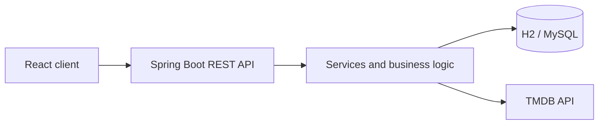

# FilmVault: Backend

> A group project developed in 2023 as part of full-stack development training.
> The repository demonstrates team collaboration, translating application requirements into technical solutions, REST API development, database modelling, and integration with an external API.

## About the project

FilmVault is a Java and React application designed to help users discover movies and TV series and check their availability on selected streaming platforms.

The application allows users to:

* create an account and authenticate;
* select their region and preferred VOD platforms;
* search for movies and TV series;
* retrieve title details and streaming availability from an external API;
* add watched movies and TV series to their profile;
* browse popular and recently released titles.

This repository contains the Spring Boot backend.
The React frontend was developed as a separate part of the project by [MWolok](https://github.com/MWolok) and is available in the [FilmVault Client repository](https://github.com/MWolok/FilmValut).

## Project status

This is an archived educational project and is not actively maintained.

The repository reflects the team's experience and technical decisions at the time of development. It is kept public as a record of collaborative work and practical experience with Java, Spring Boot, REST APIs, and external system integration.

The project should not be considered production-ready without addressing the technical debt listed below.

## My role and contribution

I acted as the group and project leader. My responsibilities included:

* coordinating team meetings and organising the development schedule;
* helping define the application scope, requirements, and business logic;
* dividing and prioritising development work;
* creating the initial project structure;
* contributing to entity and data model design;
* implementing and maintaining DTOs and MapStruct mappings;
* implementing database data initialisation;
* contributing to REST endpoints and CRUD operations;
* developing methods for communication with The Movie Database API;
* working on search functionality and result processing;
* debugging integration issues and coordinating changes across application layers.

## Team

| Contributor                           | Main areas of responsibility                                                                                                       |
| ------------------------------------- | ---------------------------------------------------------------------------------------------------------------------------------- |
| [dwydm](https://github.com/dwydm)     | Project leadership, requirements, business logic, DTOs, MapStruct, data initialisation, REST endpoints, API integration and search |
| [k2esone](https://github.com/k2esone) | Spring Security, JWT authentication and n-gram search                                                                              |
| [RadBia](https://github.com/RadBia)   | Database logic, entity design and external API integration                                                                         |
| [MWolok](https://github.com/MWolok)   | Frontend development and UI implementation                                                                                         |

## Technology stack

* Java
* Spring Boot
* Spring Web
* Spring Data JPA / Hibernate
* Spring Security and JWT
* REST API
* OpenAPI / Swagger
* MapStruct
* H2 and MySQL
* Maven
* Docker
* Git and GitHub
* React - separate frontend repository
* The Movie Database API

## High-level architecture



## API documentation

Swagger/OpenAPI support is included in the project.

When the application is running, the Swagger UI can be configured by adding the following property:

```properties
springdoc.swagger-ui.path=/swagger-ui.html
```

The documentation should then be available at:

```text
http://localhost:8080/swagger-ui.html
```

## Local setup

> The setup instructions reflect the original development configuration and have not been revalidated since the project was archived.

### Requirements

* Java 17
* Maven or the included Maven Wrapper
* a valid API key for [The Movie Database API](https://developer.themoviedb.org/docs)
* local database configuration, depending on the selected profile

Clone the backend repository:

```bash
git clone https://github.com/dwydm/FilmVault.git
cd FilmVault
```

Create `src/main/resources/application.properties` and add your API key:

```properties
media.api.key=YOUR_TMDB_API_KEY
springdoc.swagger-ui.path=/swagger-ui.html
```

On Linux or macOS, the application can be started with:

```bash
bash mvnw spring-boot:run
```

On Windows:

```powershell
mvnw.cmd spring-boot:run
```

Additional local configuration may be necessary because the original database profile files are not included in the repository.

## Known issues and technical debt

The following areas should be addressed before treating the application as production-ready:

* The JWT signing secret is currently stored in the source code and should be moved to an environment variable or external configuration.
* Automated test coverage is minimal and meaningful unit and integration tests still need to be implemented.
* The Docker configuration requires correction and verification against the current application structure.
* The Maven configuration requires cleanup, including consistent Java version settings and removal of duplicated dependencies.
* Local database profiles and configuration are not fully documented or included in the repository.
* Error handling, validation, endpoint naming, and API response consistency require further refactoring.
* User-facing DTOs and security boundaries should be reviewed to ensure that sensitive fields are never exposed.
* Authentication configuration and CORS policy require hardening before deployment.

## What the project demonstrates

Despite its educational and archived status, the project documents practical experience with:

* translating application requirements into backend functionality;
* coordinating work in a small development team;
* designing and consuming REST APIs;
* integrating an application with an external service;
* modelling entities and relationships with JPA;
* separating entities from API contracts using DTOs;
* working with feature branches and collaborative Git workflows;
* debugging problems across controllers, services, repositories, and external integrations.
